

  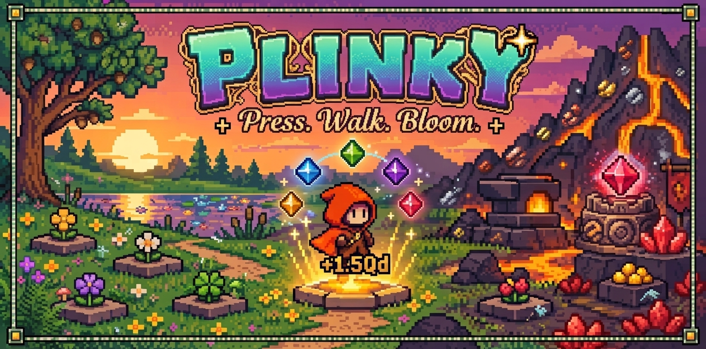

<h3 align="center">An isometric pixel incremental. Press pads, walk the meadow, bloom, and forge your way into the quarry.</h3>

  

---

  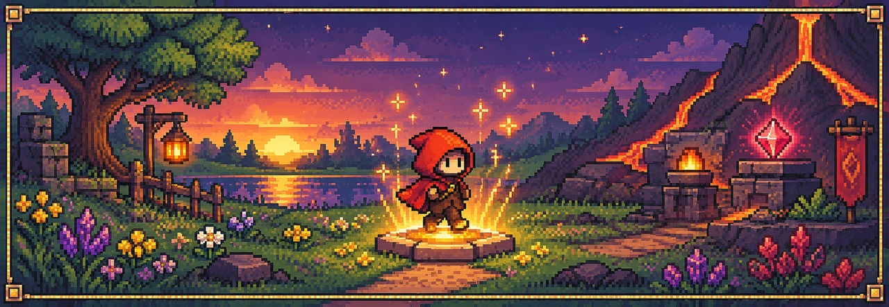

## 🌱 Pads and the Walker

Every pad is a press. The walker strolls the meadow, lands on a pad, and each press pays out in that pad's currency. Pads come in rows, and each row drives one stat. Press faster, walk further, and the pads start to sing.

  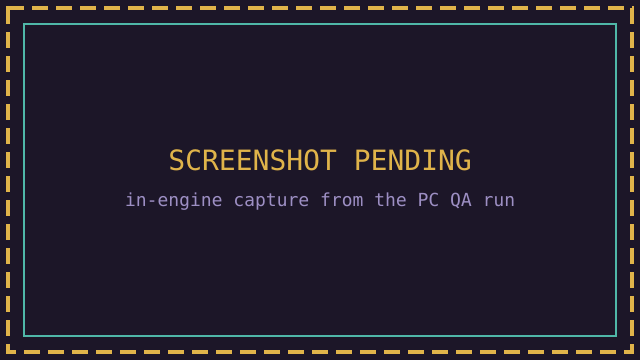
   <i>Screenshot slot: the walker on a meadow pad with the Momentum meter filling.</i>

---

  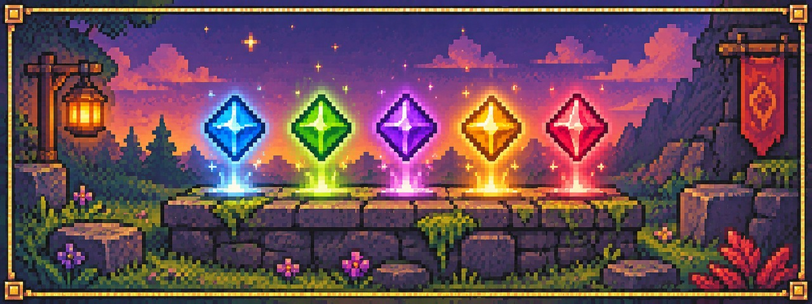

## 💎 Currencies

Each zone has its own ladder of currencies. Meadow pads pay the flower ladder, and the Ember Quarry pays the forge ladder. Bloom and Nucleus pay the two resets.

  
   <i>Meadow ladder: Sunlight, Dewdrops, Clover Leaves, Thistle Down, Heather Sprigs, Foxglove Bells, Starbloom Petals, and Seeds from Bloom.</i>

  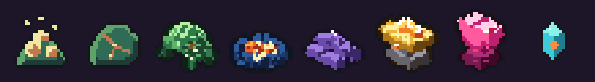
   <i>Ember Quarry ladder: Embers, Cinder, Iron Ore, Slag, Ingots, Alloys, Emberhearts, and Core Shards from Nucleus.</i>

---

  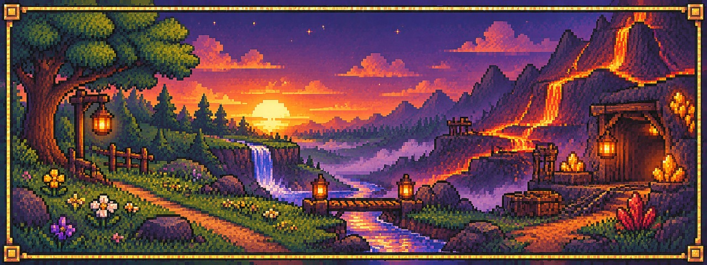

## 🗺️ Zones

<table>
  <tr>
    <td align="center" width="33%">
      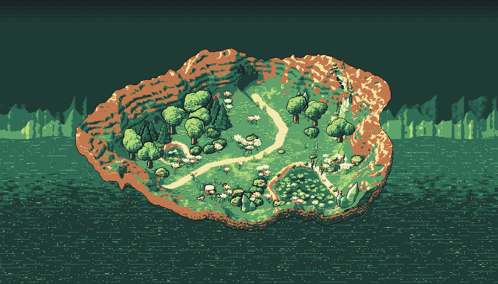
       <b>The Meadow</b> Starting Clearing and Standing Stones. Sunlight, dewdrops, and the flower ladder.
    </td>
    <td align="center" width="33%">
      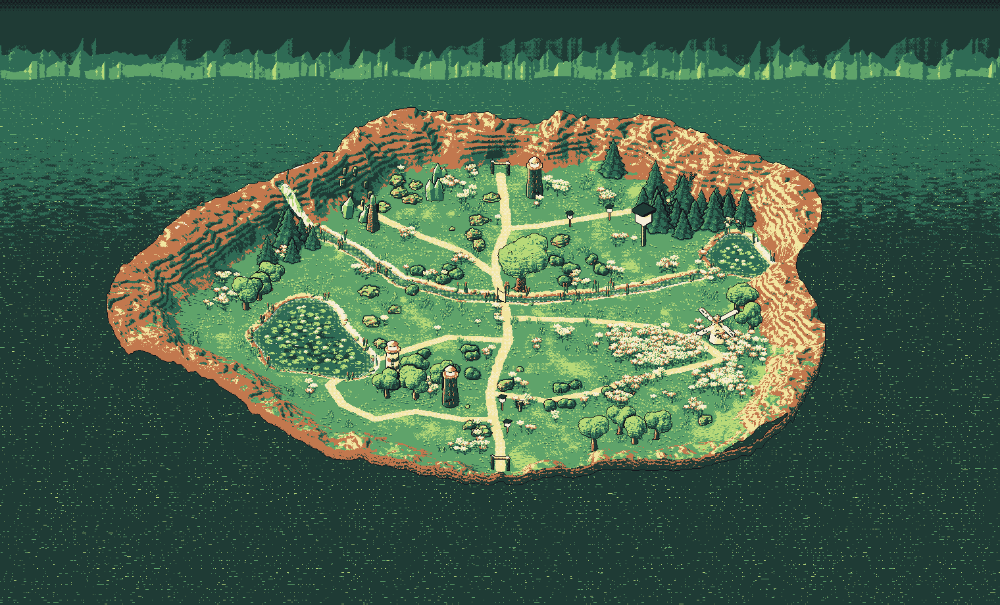
       <b>Larkmoor</b> Heronmere by the lake, plus Lanternwood, Cairnfold and Emberwatch. Sprout and Clover rows.
    </td>
    <td align="center" width="33%">
      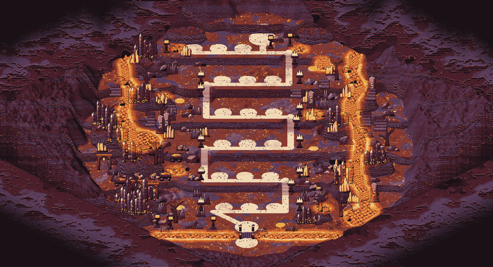
       <b>Ember Quarry</b> Forge Floor and the ember ladder. Slag, ingots, alloys, and emberhearts.
    </td>
  </tr>
</table>

---

  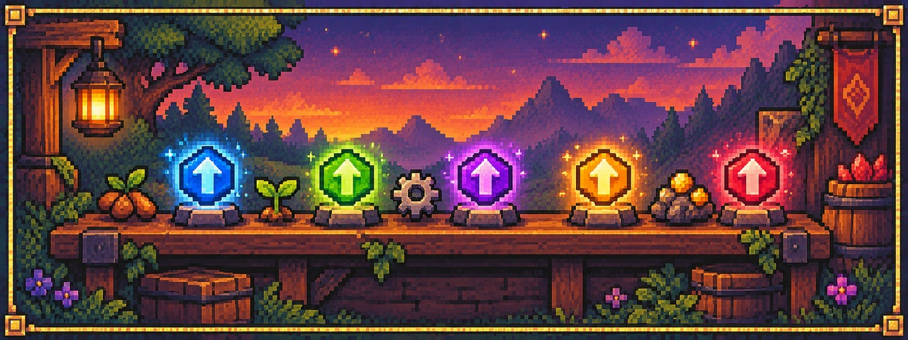

## 🛠️ Upgrades Gallery

Upgrades live in a card gallery, one tab per zone and reset. Cards glow green when you can afford them, red when you can't, and gold once they're maxed. Hover for the full breakdown.

  
   <i>Screenshot slot: the upgrades gallery, card grid with tiers.</i>

---

  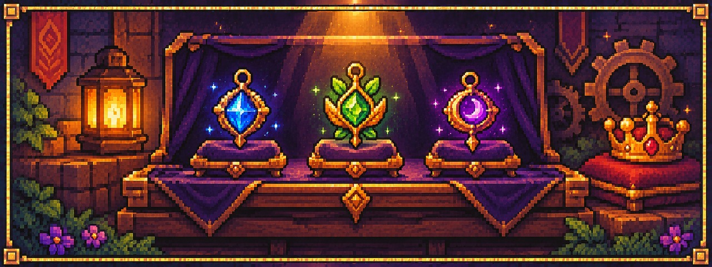

## 🏺 Relics

Relics drop on successful presses. Every relic has a rarity, and each one changes a part of the engine: income, press rate, crit, double rewards, or a pulse that presses its neighbours.

  
   <i>Rarity frames: Common, Uncommon, Rare, Epic, Legendary, Mythic, Divine, Special.</i>

  
   <i>Screenshot slot: the relic panel with equipped slots.</i>

---

  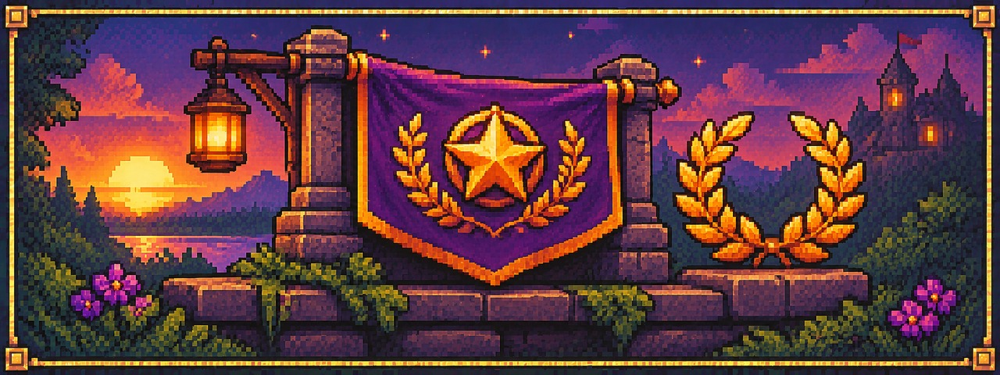

## 🏆 Achievements

Forty achievements track your first press, your crit streaks, your mastery in each meadow flower, your journey to Larkmoor, and your first trip into the quarry. Open them from the hamburger tile.

  
   <i>Screenshot slot: the achievements panel.</i>

---

  

## 🌸 Bloom Ascension

Bloom is the meadow reset. Spend the meadow's progress to start again, keep your Bloom attributes, and earn Seeds. Each reset adds a themed bloom sequence and a gift.

  
   <i>Screenshot slot: the Bloom ascension moment.</i>

---

## 🔥 Nucleus Ascension

Nucleus is the Ember Quarry reset. It pays Core Shards, keeps your Nucleus attributes, and sends you back up with a forge-lit sequence and a gift.

  
   <i>Screenshot slot: the Nucleus ascension moment.</i>

---

  

## 🍂 Seasons

The calendar runs on a clock. A day is three minutes and a night is two. Every two months the season changes, and the meadow's palette and sky turn with it.

<table>
  <tr>
    <td align="center"><b>Spring</b> Petals on the wind.</td>
    <td align="center"><b>Summer</b> Long gold days and deep green.</td>
    <td align="center"><b>Autumn</b> The leaves turn and the mist rolls in.</td>
    <td align="center"><b>Winter</b> Snow settles. Everything goes quiet.</td>
  </tr>
  <tr>
    <td></td>
    <td></td>
    <td></td>
    <td></td>
  </tr>
</table>

---

  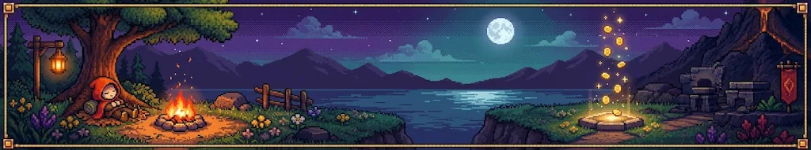

## 🌙 Offline Income

Plinky keeps working while you're away. Offline progress pays half of your normal income, up to a base cap of two hours. The Offline gain attribute stretches that cap by an hour per level. When you come back, the Welcome Back card shows what you earned.

  
   <i>Screenshot slot: the Welcome Back card after time away.</i>

---

  Design notes and balance numbers live in <a href="docs/SPEC.md">docs/SPEC.md</a>, <a href="docs/features.md">docs/features.md</a> and <a href="docs/relics.md">docs/relics.md</a>. 
  Work flow for contributors: <a href="docs/workflow.md">docs/workflow.md</a>.

